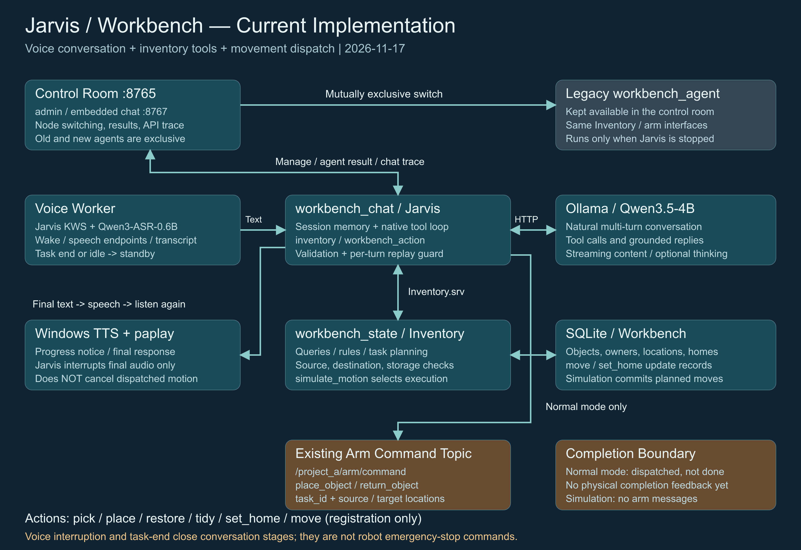

# Jarvis：工作台控制室的語音對話 Agent

2026-11-17。新版節點為 `/workbench_chat`，舊版 `/workbench_agent` 保留。控制室入口 **http://localhost:8765**，內嵌 Jarvis 對話與 API 監控；獨立監控仍可從 **http://localhost:8767** 開啟。

新版承接舊輸入／結果 Topic，提供自然對話、上下文、資料庫查詢、語音喚醒及可打斷的最終朗讀。新版已加入拿取、放置、歸位、清理桌面、設定歸位規則與位置登記，沿用既有 Inventory 與手臂 Topic。語音喚醒不是身分驗證；執行動作前須選擇使用者。

## 操作方式

1. 在控制室「節點管理」啟動資料庫狀態與「Jarvis 對話 Agent（新版／含搬運）」。示範啟動器會自動啟動這兩項。
2. 在內嵌 Jarvis 面板選「小安 U_A」，按「開始新對話」，再按「啟用 Jarvis 喚醒」。等待載入完成。
3. 待機時說 **Jarvis**，短暫停頓，畫面顯示聆聽後再說「我的筆在哪裡？」。問題說完停頓約 0.9 秒即可，不必按錄音鍵。
4. 回答播完會自動續聽，可追問「那它的預設歸位位置呢？」。
5. **最終答案朗讀中**，再次說 Jarvis：立即停止播放，接著可說新問題。處理中的等待提示不接受此喚醒打斷。
6. 說「任務結束」（也接受「結束任務」「結束語音對話」），或約 60 秒沒有有效輸入，會回到只偵測名字的待機狀態。
7. 按「關閉麥克風」才會完全關閉音訊程序；待機仍需收音以偵測名字。頁面重整不會自行關掉後端麥克風。

使用英文發音 Jarvis 或 Hey Jarvis。名字辨識使用獨立的本機 KWS 模型，不讓 LLM 猜測是否喚醒。個人口音、噪音及外放回音仍需現場驗收；建議先用耳機。系統不具備完整聲學回音消除，朗讀時會將回答內的喚醒名字替換成「助理」，降低自我喚醒機會。

使用者可連續輪流交談；只有最終答案播放階段及待機階段允許 KWS 喚醒。ASR、LLM 推論、工具查詢及「正在處理」提示期間，名字不會中止正在執行的請求。按「關閉麥克風」會停止後續播放／收音，但已開始的模型與工具輪次仍可能完成並顯示在畫面。

## 啟動測試控制室

在 Ubuntu-D：

```bash
cd /mnt/d/Robotics/project_a_ws
source /opt/ros/humble/setup.bash
colcon build --symlink-install --packages-select workbench_interfaces project_a_llm
source install/setup.bash
python3 scripts/chat_demo.py
```

開啟 [工作台控制室](http://localhost:8765)。啟動器以 SQLite backup 複製工作台資料到臨時目錄，在 **ROS domain 88** 啟動 admin，由 admin 管理 state 與 chat，因此可直接在控制室切換新舊 Agent。state 使用副本的模擬模式。Ctrl+C 關閉控制室與它管理的節點，並清除副本。

domain 88 必須留給這個測試；不要同時在該 domain 啟動第二個 state。控制室已運行時，再次執行啟動器只顯示網址，不接管或重啟原程序。若舊獨立 8767 示範仍在運行，先在其啟動終端 Ctrl+C 再啟動新版控制室。

```bash
# 自訂埠與未使用的 ROS domain
PROJECT_A_ADMIN_PORT=8775 PROJECT_A_CHAT_PORT=8777 PROJECT_A_CHAT_DOMAIN=89 python3 scripts/chat_demo.py
```

使用原本的正式架構時，沿用既有 domain 及資料庫設定：

```bash
source /mnt/d/Robotics/project_a_ws/install/setup.bash
ros2 run project_a_llm admin
```

從控制室啟動所需節點。啟動 Jarvis 會停止由同一控制室管理的舊 Agent，啟動舊 Agent 也會停止 Jarvis；若另一版本是外部終端啟動，控制室會要求先在原終端停止，不強制殺掉未知程序。切換會清除被停止節點的 RAM 對話。

目前 Windows 有既有 8766 portproxy，因此本版使用 8767，沒有改動轉發或防火牆。

## 音訊依賴與配置

主 ROS Python 不需要載入模型庫。獨立 ASR venv 須包含 `qwen_asr`、Torch、NumPy。原開發機預設路徑為：

```text
/home/ktliu/MakeNTU/emotion_robot_controller/voice_stt_remote/windows_desktop_server_bundle/.venv/bin/python
```

其他機器先設定 `PROJECT_A_ASR_PYTHON`。喚醒依賴與官方小型模型可用以下指令安裝（目前開發機已完成）：

```bash
python3 scripts/setup_jarvis_voice.py
```

此腳本安裝 sherpa-onnx 2.0.1、sentencepiece 0.2.3 到指定 ASR venv，下載官方 English 3.3M KWS 模型到 `~/.cache/project_a/kws/`；不提交模型權重至 Git。首次 ASR 載入會下載／使用 Hugging Face 快取的 Qwen3-ASR-0.6B。

系統另需 `pulseaudio-utils`（parec、paplay）、`icu-devtools`（uconv）、Windows 已安裝的中文 TTS 語音。WSLg 的 RDPSource 取得 Windows 預設麥克風；Windows TTS 先產生臨時 WAV，WSLg 播放程序負責輸出及立即取消，臨時檔案在播完或中止後刪除。

| 環境變數 | 預設／用途 |
| --- | --- |
| PROJECT_A_CHAT_MODEL | qwen3.5:4b |
| PROJECT_A_ASR_PYTHON | 上述 venv 路徑 |
| PROJECT_A_ASR_MODEL | Qwen/Qwen3-ASR-0.6B |
| PROJECT_A_ASR_DEVICE | 有 CUDA 時 cuda:0，否則 cpu；記憶體不足可指定 cpu |
| PROJECT_A_ASR_THREADS | 6，CPU 運算執行緒 |
| PROJECT_A_VOICE_SOURCE | RDPSource |
| PROJECT_A_VOICE_RMS | 0.012；太吵提高、聲音太小降低 |
| PROJECT_A_VOICE_IDLE_SECONDS | 60；只計算等待使用者輸入時間，不計模型／播報耗時 |
| PROJECT_A_WAKE_THRESHOLD | 0.25；提高會較難喚醒，需現場校準 |
| PROJECT_A_KWS_MODEL_DIR | `~/.cache/project_a/kws/sherpa-onnx-kws-zipformer-gigaspeech-3.3M-2024-01-01` |
| PROJECT_A_TTS_SINK | 未指定時使用 PulseAudio 預設輸出；測試可指定虛擬輸出 |

這些配置在啟動控制室／chat 前設定。第一次初始化包含 ASR 暖機，完成後才進入待機。LLM 思考模式可在啟用喚醒前勾選，語音會話中固定不變。

## 搬運與清理桌面

| 指令範例 | 動作 |
| --- | --- |
| 幫我拿我的筆 | pick：拿到工作檯桌面 |
| 把我的筆放到交付區 | place：放到指定位置 |
| 把我的筆歸位 | restore：放回預設儲位 |
| 清理桌面 | tidy：所有桌面物品依各自規則歸位 |
| 清理桌面上我的東西 | tidy + @me：只整理本人的桌面物品 |
| 把我的筆的預設位置改為 B2 | set_home：修改收納規則 |
| 將我的筆的位置登記為工作檯桌面 | move：只更新位置紀錄，不搬運 |

清理桌面不含交付區。目的地沿用既有儲位、唯一物品與容量檢查；放置只允許物品預設儲位、桌面或交付區。模型可由歷史理解「它」，設定歸位規則仍要求當輪明確說出物品與位置。

同一輪完全相同的動作參數只執行一次；服務逾時後不自動重送。這是記憶體內防重，並非跨重啟的持久交易。一般模式回傳 execution=dispatched，表示已發布 Topic，尚未得到手臂完成回報；模擬模式為 simulated，且不發布手臂命令。set_home / move 即使在一般模式也會更新所選資料庫。

叫 Jarvis 打斷、任務結束、關閉麥克風都不是機械手臂急停，不能撤回已派送命令。現有架構尚未接上手臂 Action 的完成、失敗與取消回報。

## 實際架構



[SVG 向量圖](JARVIS_ARCHITECTURE.svg)；可用 `python3 docs/build_jarvis_architecture.py` 重建，安裝 resvg-py 時另輸出 PNG。

```mermaid
flowchart TD
    UI[工作台控制室 8765] --> MGMT[admin：新版／舊版互斥管理]
    UI --> PANEL[內嵌 Jarvis 對話及 API 監控 8767]
    MIC[Windows 麥克風 / WSLg] --> AUDIO[音訊 worker / RAM 緩衝]
    AUDIO --> KWS[sherpa-onnx：Jarvis 關鍵字]
    AUDIO --> ASR[Qwen3-ASR-0.6B / 繁體轉換]
    KWS --> VOICE[語音狀態機：待機／對話／最終朗讀]
    ASR --> VOICE
    VOICE --> CHAT[workbench_chat / session]
    INPUT[/project_a/agent/input] --> CHAT
    CHAT <--> MODEL[Ollama Qwen3.5-4B / 原生工具迴圈]
    CHAT <--> INV[Inventory Service / 查詢、規則、搬運規劃]
    INV --> DB[(SQLite)]
    CHAT -->|一般模式：派送| ARM[/project_a/arm/command]
    INV -->|模擬模式：更新位置| DB
    CHAT --> RESULT[/project_a/agent/result]
    CHAT --> TRACE[/project_a/chat/trace]
    TRACE --> PANEL
    TRACE --> LOG[控制室 Jarvis 日誌]
    CHAT -->|最終文字| VOICE
    VOICE --> WAV[Windows TTS → 臨時 WAV]
    WAV --> PLAYER[可取消的 paplay]
    KWS -->|僅最終朗讀時| PLAYER
    PLAYER -->|播完或被打斷| VOICE
```

語音狀態：`loading_asr → waiting_wake → listening → recognizing → processing → speaking_final → listening`。`speaking_final + Jarvis → interrupted → listening`；`任務結束 / idle_timeout → waiting_wake`；按關閉麥克風則進入 `off`。

等待超過約 4 秒時最多播報一次處理提示；提示不加入模型歷史，也不是完成證據。只朗讀最終 assistant 訊息，不讀 thinking 或工具前言。語音模式提示模型通常用一到三句口語回答，使用者要求細節仍可展開；沒有固定意圖分類表或每輪強制確認。

ASR 的音量端點偵測使用 100 ms 音框、900 ms 靜音結句、單句約 15 秒上限；PulseAudio 收音延遲設定為 100 ms。保留喚醒判定後、播放器停止期間的音框，排除喚醒詞尾音。先叫名字並短暫停頓再說問題；連在同一句且沒有停頓的辨識不保證。音訊環形緩衝最多約 40 秒，只在 RAM；未喚醒的音訊不送完整 ASR 或 LLM，也不保存錄音。

## 舊 ROS 架構的接法

| 介面 | 新版行為 |
| --- | --- |
| `/project_a/agent/input` String | 接收 utterance_id、text、user_id；同 user_id 的舊輸入沿用會話；同 ID 相同內容去重，不同內容報 ID_CONFLICT |
| `/project_a/agent/result` String | 保留 utterance_id、status、message，新增 session_id、turn_id，tool=chat |
| `/project_a/speech/command` String | 從舊 input 進來的結果仍發送，供既有 speaker 使用；Jarvis 麥克風對話由自身播放器處理，不重複發布 |
| `/project_a/workbench/inventory` | 沿用原 srv 型別，支援查詢與六種工作台動作 |
| `/project_a/chat/trace` String | 模型、工具與 voice_* 事件；控制室寫入 chat 日誌 |
| `/project_a/arm/command` | 一般模式發布 place_object / return_object；模擬模式不發布 |

控制室的模擬語音仍經 mock_speech 進正式 input；舊 microphone 單次錄音也可以送到新版。使用 Jarvis 喚醒時不需啟動舊 microphone 或 speaker。不要手動同時啟動兩個版本；新版偵測到舊節點時不處理正式 input，控制室互斥管理是主要切換機制。

正式 input 的工具細節可從控制室選「Jarvis」日誌查看；內嵌對話面板顯示該瀏覽器會話的完整時序。

## 監控、工具與記憶

模型自由決定是否查詢，role=tool 結果會回到 messages，允許多次查詢後回答。工具分為只讀 inventory 與 workbench_action；不暴露 SQL、shell 或手臂腳本。`我的` 若模型漏填 person，程式補 @me；未選 actor 就回錯誤。

這是本機可信操作者介面，手動 user_id 不是聲紋驗證／登入，未實作資料列存取控制。HTTP 只綁 loopback，校驗 Host/Origin；控制室的節點操作另要求 X-Workbench 標頭。

動作另外產生 arm_dispatch、action_result 與 tool_replay；最終派送回覆由執行回條產生，模擬回覆加上模擬標示，避免模型把派送說成搬完。

監控事件包含 model_start/end、model_metrics、tool_start/validated/end/error、turn_start/end/error 及 voice_*。可展開參數、工具結果、錯誤、時間與實際播報文字。Ollama duration 單位 ns，工具及 ASR duration_ms 為毫秒。

頁面顯示本輪成功查詢次數，避免將舊工具結果誤當成新查詢。thinking 面板只呈現外部本機模型實際提供的欄位，不代表工具已執行，也不是模型內部的完整狀態。

```bash
ROS_DOMAIN_ID=88 ros2 topic echo /project_a/chat/trace std_msgs/msg/String --full-length
```

最多保留 10 個完整成功輪次，每輪前將歷史縮到約 10000 個 JSON 字元內；保持完整工具呼叫／結果組。頁面最多 20 輪與 300 個事件，session 最多 32 個。這是字元預算，不是精準 tokenizer 計數；較早內容會被移除。失敗輪次不寫入模型歷史，thinking 不重播。

所有對話記憶在 RAM，重啟清空。任務結束會關閉當前聆聽階段但保留同一 session 近期上下文；要清空請關閉麥克風後開始新對話。模型最多 6 次往返／8 次工具，輸出上限 1024 tokens、context 8192。模型 deadline 120 秒、socket 30 秒、Inventory 2 秒 discovery／10 秒回覆；阻塞 I/O 可能再多等一次 socket timeout。

## 原始碼與驗證

| 檔案 | 用途 |
| --- | --- |
| [chat_node.py](../src/project_a_llm/project_a_llm/chat_node.py) | ROS 相容入口、HTTP、session、trace |
| [chat_core.py](../src/project_a_llm/project_a_llm/chat_core.py) | 自然對話、Ollama 串流、查詢與動作工具迴圈 |
| [chat_voice.py](../src/project_a_llm/project_a_llm/chat_voice.py) | 喚醒／對話／打斷／閒置狀態機及 TTS |
| [chat_audio_worker.py](../src/project_a_llm/project_a_llm/chat_audio_worker.py) | 持續音訊環形緩衝、端點判斷、ASR |
| [chat_kws.py](../src/project_a_llm/project_a_llm/chat_kws.py) | Jarvis／Hey Jarvis 關鍵字模型 |
| [chat.html](../src/project_a_llm/project_a_llm/chat.html) | 對話與 API 時序 |
| [chat_demo.py](../scripts/chat_demo.py) | 資料庫副本與控制室啟動器 |
| [setup_jarvis_voice.py](../scripts/setup_jarvis_voice.py) | 官方喚醒模型與依賴安裝 |

執行測試：

```bash
python3 -m pytest src/project_a_llm/test/test_chat_core.py src/project_a_llm/test/test_chat_voice.py -q
python3 src/project_a_llm/test/chat_live_smoke.py
python3 src/project_a_llm/test/jarvis_live_smoke.py
python3 -m pytest src/project_a_llm/test/test_chat_actions.py -q
python3 src/project_a_llm/test/chat_actions_live_smoke.py
```

語音測試使用 domain 87、port 18767、資料庫副本與兩個臨時 PulseAudio 虛擬裝置；合成測試語音，不錄使用者麥克風，退出時清除音訊裝置及副本。測試以 HF_HUB_OFFLINE 使用已快取的 ASR 模型，請先完成一般語音初始化。請勿與使用同 domain／port 的另一個測試同時執行。

2026-11-17 已驗證 colcon 建置、20 項核心／語音測試、控制室內嵌面板與新舊 Agent 雙向互斥切換。完整虛擬音訊測試通過：一般中文不喚醒、Jarvis 開始收音、ASR 正確轉寫「我的筆在哪裡」、Inventory 查詢成功、最終 WAV 已開始播放後由 Jarvis 中止、追問沿用筆的上下文、播完自動續聽、「任務結束」回待機、閒置回待機、手動停止與資料庫不變。閒置測試縮短為 8 秒，產品預設 60 秒。

四輪真實文字／Ollama／Inventory 整合測試再次通過，包含跨輪記憶、工具往返、會話隔離、資料庫不變；原 ROS input/result 也通過查詢、相同 ID 重送回放及不同內容 ID_CONFLICT。Qwen3-ASR-0.6B 在本機 GPU 的三次同句獨立測試為首次約 8.9 秒、暖機後約 1.04／0.82 秒；這不是多模型併行或現場語音的 p95。

小模型仍可能沿用舊查詢、混淆稱呼或編造說明。監控證據用來檢查架構與結果，不保證模型每句都正確。現場口音、喇叭回音、多人說話及喚醒閾值仍需使用者實際測試。

參考：[Ollama tool calling](https://docs.ollama.com/capabilities/tool-calling)、[Ollama thinking](https://docs.ollama.com/capabilities/thinking)、[Qwen3-ASR-0.6B](https://huggingface.co/Qwen/Qwen3-ASR-0.6B)、[sherpa-onnx 官方喚醒模型](https://k2-fsa.github.io/sherpa/onnx/kws/pretrained_models/index.html)。

搬運整合測試使用 domain 86、port 18768 與臨時資料庫；一般派送測試只接收 Topic，不連實體手臂。`chat_actions.py` 負責將 Inventory 任務轉成舊版手臂命令與執行回條。

本次搬運版驗證：Ubuntu-D colcon 建置通過，核心／語音／動作共 33 項測試通過。真實 Qwen + ROS 測試通過拿取、桌面清理、修改預設儲位、交付、歸位及位置登記；假設且要求不要執行的問題沒有產生動作。模擬搬運核對副本位置且無 arm 訊息；一般模式核對單一 arm 命令、任務 ID、來源／目的地，並確認派送後資料庫位置不變。實體手臂完成／失敗回報及現場搬運尚未驗證。
