# 工作台 Agent 操作與 ROS 2 介面

下一版的會話、記憶、聲紋隔離、任務回報與模型替換規劃見[連續對話 Harness 提案](../../docs/CONVERSATIONAL_HARNESS.md)。新增介面均尚未實作；本頁描述現行流程。

Windows 操作入口見[瀏覽器管理介面](#windows-瀏覽器管理介面)。開發串接可直接使用[通訊模板](#通訊模板)。

## 用模擬模式看物品移動

在 Ubuntu-D 的每個終端先執行 `source /mnt/d/Robotics/project_a_ws/install/setup.bash`。用 `ros2 node list` 確認哪些節點已經運行。同一個 ROS domain 只啟動一個 state；重複啟動會讓服務請求或快照來自不同實例。

| 終端 | 指令 |
| --- | --- |
| 1．啟動狀態節點 | `ros2 run project_a_llm state --ros-args -p simulate_motion:=true` |
| 2．啟動語言模型 Agent | `ros2 run project_a_llm agent` |
| 3．開啟 WSLg 監看視窗 | `ros2 run project_a_llm monitor` |
| 4．監聽每次發話結果 | `ros2 topic echo /project_a/agent/result --full-length` |

在另一個已載入環境的 Bash 終端模擬語音節點，每句等到結果後再送下一句：

```bash
say() {
  local msg
  msg=$(python3 -c 'import sys,json,uuid; event=dict(utterance_id=str(uuid.uuid4()),user_id=sys.argv[1],text=sys.argv[2]); print(json.dumps(dict(data=json.dumps(event,ensure_ascii=False)),ensure_ascii=False))' "$1" "$2") || return
  ros2 topic pub --once /project_a/agent/input std_msgs/msg/String "$msg"
}
say U_A '我想要把橡皮擦拿去桌面'
say U_A '我想要把尺拿去桌面'
say U_A '清理桌面'
```

模擬模式直接寫入 state 使用的 SQLite。要保留正式配置，可在啟動 state 時加上 `-p db_path:=/絕對路徑/資料庫副本.sqlite3`。預設檔案是 `/mnt/d/Robotics/project_a_ws/data/workbench.sqlite3`。已有資料會沿用；新路徑只建立空表和位置。

## 區域、所有者與歸位規則

| 區域 | 初始登記 | 使用規則 |
| --- | --- | --- |
| A 區 | A1 筆 P01、A2 橡皮擦 E01，屬於小安 U_A | 每格一件 |
| B 區 | B1 尺 R01，屬於小林 U_B；B2 空 | 每格一件 |
| 工作檯桌面 | 空 | 暫放區，容量未設上限。單純取物時預設送到這裡。 |
| 交付區 | 空 | 暫放區，容量未設上限。取物時可明確指定交付區。清理桌面只處理桌上的物品。 |

每件物品的 `location` 記錄目前位置，`home_location` 記錄持久化歸位規則。暫放、取物及清桌都保留原規則。只有明確的變更指令能更新預設位置；單件儲位不能同時預留給兩件物品。桌面與交付區不能設成預設位置。「我的」依輸入的 user_id 篩選；單憑物品名稱可查或搬動其他人的唯一物品。本機介面目前信任呼叫端提供的身分。

| 指令或用途 | 工具 | 實際行為 |
| --- | --- | --- |
| 查看整個資料庫的狀態／我的橡皮擦在哪裡／查詢小林的使用者資料 | status／objects／users | 回傳資料庫現況、符合條件的物品或使用者 |
| 幫我拿我的筆 | pick | 查得唯一物品及已知來源後，規劃送到工作檯桌面 |
| 我想要把橡皮擦拿去桌面／幫我拿我的筆到交付區 | place | 允許暫放，保留 home_location |
| 把尺放到 B2 | place | 若尺的預設是 B1，即使 B2 是空位也拒絕 |
| 把筆的預設位置改為 B2 | set_home | 檢查占用與預留後修改規則。目前位置保留；下次歸位使用新規則 |
| 把筆歸位／清理桌面 | restore／tidy | 分別產生單件或整個桌面的歸位任務，目的地取自各物品自己的 home_location；已在目的地時 tasks 為空 |
| 把 P01 的位置更新為 A1 | move | 確認已搬運後直接登記目前位置；接受預設儲位或暫放區，成功後發布新快照 |

## 模擬完成與一般派送

| 模式 | 搬運請求成功時 | 監看視窗和手臂輸出 |
| --- | --- | --- |
| 模擬 `simulate_motion:=true` | state 在一筆 SQLite 交易內更新整批任務的 location，提交後發布快照；結果含 `simulated:true` | 視窗跟隨快照；Agent 發布模擬完成語音文字，省略實體手臂命令 |
| 一般 `simulate_motion:=false`（啟動預設） | state 回傳任務清單；Agent 對每一筆發布手臂命令 | 派送後視窗保留已登記位置。外部執行器確認完成後，可用 move 更新位置。實體控制器回報尚待整合 |

若收到 ok 但視窗沒移動，先檢查回覆有無 `result.simulated`、是否有待搬運的 tasks，再查執行中的模式與快照：

```bash
ros2 param get /workbench_state simulate_motion
ros2 topic info /project_a/workbench/state
ros2 topic echo --once --full-length --qos-reliability reliable --qos-durability transient_local /project_a/workbench/state std_msgs/msg/String
```

監看節點按區域繪製儲位、物品名稱、編號、所有者與空位。晚開啟也能取得最近快照；來源離線時保留畫面並標示狀態。舊式快照只有 objects 與 users 時，視窗使用預設配置繪圖。CLI 直接寫入同一 SQLite 檔案時，state 每秒檢查外部提交。

## 架構與介面

```mermaid
flowchart LR
    W["Windows 瀏覽器"] <-->|HTTP localhost:8765| AD
    MIC["Windows 預設麥克風"]
    subgraph Ubuntu["Ubuntu-D · ROS 2 Humble"]
      AD["workbench_admin"] -->|test/utterance| M["workbench_mock_speech"]
      M -->|agent/input| A["workbench_agent"]
      MIC -->|WSLg 音訊| SRC["RDPSource · parec"]
      SRC -->|16 kHz 單聲道 PCM| ASR["workbench_microphone · Qwen3-ASR-1.7B"]
      AD -->|子程序 stdin 觸發錄音| ASR
      ASR -->|stdout 回報進度與辨識文字| AD
      ASR -->|agent/input| A
      V["終端發布者"] -->|agent/input| A
      A <-->|HTTP /api/chat| Q["Ollama · Qwen"]
      A <-->|workbench/inventory Service| S["workbench_state"]
      S <--> DB[(SQLite)]
      C["inventory CLI"] <--> DB
      S -->|workbench/state| AD
      S -->|workbench/state| UI["workbench_monitor · WSLg"]
      A -->|agent/result| AD
      A -->|一般模式 arm/command| ARM["手臂控制端 · 待接"]
      A -->|speech/command| TTS["語音輸出端 · 待接"]
      LOG["/rosout 與所管理程序的 stdout、stderr"] --> AD
      AD --> FILE["各節點輪替日誌"]
    end
```



Agent 先辨識明確句型，其餘文字經本機 Ollama 的 `/api/chat` 交給 Qwen。預設模型為 `qwen3:4b`，可在 agent 啟動時用 `--ros-args -p model:=qwen3:4b` 指定。工具欄位見 [Qwen JSON 格式](QWEN_OUTPUT_FORMAT.md)。

管理頁可啟停 state、agent、monitor、mock_speech 與 microphone。手動輸入的測試文字經 mock_speech 轉送；麥克風節點在 Ubuntu-D 本機辨識錄音後，直接發布到同一個 Agent 入口。瀏覽器透過 HTTP 觸發錄音並讀取文字，音訊由 WSLg 提供。

以下端點全部以 `/project_a/` 開頭。Topic 型別為 `std_msgs/msg/String`，data 是 UTF-8 JSON 字串。一般 Topic 為 reliable、volatile、keep last 10。state 快照為 reliable、transient local、keep last 1。

| 端點 | 方向 | JSON 欄位或型別 |
| --- | --- | --- |
| test/utterance | admin → mock_speech | 與 agent/input 相同的 JSON，由 mock_speech 原樣轉發 |
| agent/input | microphone、mock_speech 或終端 → Agent | 必填非空字串 utterance_id、text；選填字串 user_id、target_zone。方位保留供後續交付使用 |
| agent/result | Agent → 呼叫端 | utterance_id、status。ok 附 tool、result；clarify 附 message；error 附 error |
| workbench/inventory | Agent 或其他 client ↔ state | workbench_interfaces/srv/Inventory，定義見下方 |
| workbench/state | state → monitor、admin | objects[] 含 object_id、name、owner、location、home_location；users[] 含 user_id、name；locations[] 含 location、zone、capacity，null 表示未設定容量上限 |
| arm/command | Agent → 手臂訂閱端 | utterance_id、task_id、user_id、api、args。api 為 place_object（桌面或交付區）或 return_object（歸位）。args 含 object_id、source_location、target_location |
| speech/command | Agent → 語音合成訂閱端 | utterance_id、text。例如「模擬搬運完成。」或「已發出放置指令。」 |

Inventory 請求是六個字串：action、item、location、person、text、user_id。item 可為名稱或 ID；person 可為名稱、ID 或 @me。回覆是 bool ok、string result_json、string error；成功時解析 result_json。查詢回覆對應的資料陣列。move 回覆 object_id、previous_location、location；set_home 回覆 object_id、home_location、location。pick、place、restore、tidy 回覆 tasks，每筆含 object_id、source_location、target_location。pick 缺少唯一物品或來源不明時可回 clarification。資料庫服務離線或逾時會以 error 回覆呼叫端。

```bash
ros2 interface show workbench_interfaces/srv/Inventory
ros2 service call /project_a/workbench/inventory workbench_interfaces/srv/Inventory "{action: status}"
ros2 topic echo /project_a/arm/command --full-length
ros2 topic echo /project_a/speech/command --full-length
```

每次新發話使用新 utterance_id。Agent 最多接受 16 筆處理中或排隊的發話；滿載回 QUEUE_FULL。同一次啟動會快取最近 512 筆成功或澄清結果，重送同一 ID 與內容時回傳快取；同 ID 不同內容回 ID_CONFLICT。一般模式依發話、動作及物品產生穩定的 task_id，供未來手臂端去重。

## 2026-11-09 驗證紀錄

在 Ubuntu-D 的 ROS 2 Humble，以獨立 ROS domain 和正式 SQLite 的臨時副本測試。先在副本將三件物品放回原儲位，再從 agent/input 送入中文；核對 agent/result、SQLite、監看元件與輸出 Topic。

| 核對項目 | 觀察結果 |
| --- | --- |
| 資料與身分查詢 | status 回六個位置；「我的橡皮擦」回 U_A 的 E01；小林資料回 U_B |
| 兩件物品暫放與清桌 | 橡皮擦、尺出現在監看視窗的桌面區，SQLite 保留 A2、B1 歸位規則。清桌一次回兩筆任務，物品回原位，桌面顯示空位 |
| 儲存限制 | 將尺放到空的 B2、將尺預設為桌面，均收到預期的 error |
| 明確修改與單件歸位 | 把筆的預設改為 B2 時仍位於 A1，歸位後才移至 B2 |
| 取物與交付區 | 未指定目的地時筆移到桌面；指定交付區後筆移到交付區。此時清桌回空任務 |
| 模擬輸出 | 收到 simulated=true 和「模擬搬運完成。」；測試期間手臂訂閱端收到零筆命令 |

一般模式另以獨立副本驗證：收到 place_object（A2 → 工作檯桌面）與 return_object（工作檯桌面 → A2）；兩次派送後 SQLite 仍保留當次來源位置。重啟 state 期間也觀察到 STATE_UNAVAILABLE，請待服務可用後重送。

截至 11 月 9 日，實體手臂取放、語音辨識及喇叭播放仍待測試。

## 2026-11-13 麥克風整合驗證紀錄

| 測試入口 | 實際觀察 |
| --- | --- |
| Ubuntu-D 錄音 | WSLg 列出 RDPSource，錄製一秒取得 32,000 bytes 的 16 kHz、16-bit 單聲道音訊。 |
| 中文音檔 → ROS | 用中文合成音檔執行 microphone，獨立 ROS domain 的 agent/input 訂閱端收到「请问，工作台桌面上有哪些物品？」、新的 utterance_id 及 U_A。模型可能輸出簡體字。 |
| Web 管理 API → 電腦麥克風 | 經 API 啟動節點、等待 ready、觸發五秒錄音。觀察到 recording、recognizing，再回到 ready；狀態回覆包含辨識文字，隨後成功停止節點。 |

待驗證：由使用者說出指定問句，核對辨識文字與同次 agent/result 的查詢回覆。


## Windows 瀏覽器管理介面

在 PowerShell 執行以下指令並保持終端開啟，Windows 瀏覽器開啟 http://localhost:8765 。服務在 Ubuntu-D 監聽 127.0.0.1，使用 WSL 的 localhost 轉送。若要更換連接埠，在 admin 後加上 `--ros-args -p port:=8766`。

```powershell
wsl -d Ubuntu-D -- bash -lc 'source /mnt/d/Robotics/project_a_ws/install/setup.bash && ros2 run project_a_llm admin'
```

開啟網頁後，選「模擬搬運」，依序啟動資料庫狀態、語言模型 Agent、模擬語音。Web 本身即可看分布，需要獨立視窗時再啟動桌面監看。測完在啟動 admin 的 PowerShell 按 Ctrl+C。

管理節點 /workbench_admin 會顯示 state、agent、monitor、mock_speech 與 microphone 的 ROS 註冊狀態。由網頁啟動的節點可在頁內停止；外部啟動的節點顯示為外部執行，由原終端控制。狀態節點啟動前可選模擬或一般模式。admin 正常關閉時會一併停止其子程序。其他 ROS 節點可繼續照原方式發布發話。

管理頁直接訂閱 workbench/state，依位置顯示物品與歸位規則。啟動 state、agent 和 mock_speech 後，在模擬語音區填入使用者、方位及文字。admin 產生新 utterance_id，向 /project_a/test/utterance 發布 std_msgs/msg/String，格式與 agent/input 相同。/workbench_mock_speech 將訊息轉發至 /project_a/agent/input；頁面依 ID 顯示 /project_a/agent/result。測試發話會套用目前 state 選擇的模式與資料庫，使用副本時可在啟動 admin 前設定 PROJECT_A_DB。

使用電腦麥克風時，在「節點管理」啟動「麥克風（Qwen3-ASR）」。待「麥克風語音測試」顯示「可以錄音」，填入使用者後按「錄音 5 秒」，說「我的橡皮擦在哪裡？」。辨識文字顯示在錄音區。只測轉文字時啟動 microphone 即可；要查工作台資料，錄音前也要啟動 state 和 agent。從終端啟動的 microphone 使用 Enter 觸發錄音。

日誌頁提供最近 45 行與目前日誌檔下載。WSL 的 `$XDG_STATE_HOME/project_a/logs`（預設 `~/.local/state/project_a/logs`）依節點存放 ROS 日誌、管理程式擷取的標準輸出與錯誤，以及測試發話／Agent 回覆。每檔 1 MiB 輪替，最多保留兩份舊檔。

## 通訊模板

以下用「我想要把橡皮擦拿去桌面」串起同一次發話。範例值可替換。一般 ROS Topic 的 JSON 都裝在 `std_msgs/msg/String.data`；Service 使用強型別欄位。只有 `result_json` 與 Ollama 的 `message.content` 需要再解析一次 JSON。所有時間、位置與節點狀態均為示例。

### 語音輸入與 Agent 輸出

`/project_a/test/utterance` 和 `/project_a/agent/input` 共用以下 data 內容。真實語音端直接發布至後者；每段新發話應換新 ID。

```json
{
  "utterance_id": "demo-001",
  "text": "我想要把橡皮擦拿去桌面",
  "user_id": "U_A",
  "target_zone": "UNKNOWN"
}
```

在已載入 ROS 環境的 Ubuntu-D 終端可直接發布相同內容。這條命令會依運行模式產生搬運效果。

```bash
ros2 topic pub --once /project_a/agent/input std_msgs/msg/String '{"data":"{\"utterance_id\":\"demo-001\",\"text\":\"我想要把橡皮擦拿去桌面\",\"user_id\":\"U_A\",\"target_zone\":\"UNKNOWN\"}"}'
```

| Topic／情境 | data 內容 |
| --- | --- |
| agent/result · 模擬完成 | `{"utterance_id":"demo-001","status":"ok","tool":"place","result":{"tasks":[{"object_id":"E01","source_location":"A2","target_location":"工作檯桌面"}],"simulated":true}}` |
| agent/result · 一般模式已派送 | `{"utterance_id":"demo-001","status":"ok","tool":"place","result":{"tasks":[{"object_id":"E01","source_location":"A2","target_location":"工作檯桌面"}]}}` |
| agent/result · 需澄清 | `{"utterance_id":"demo-001","status":"clarify","message":"請指定唯一的物品名稱或編號。"}` |
| agent/result · 服務錯誤 | `{"utterance_id":"demo-001","status":"error","error":"STATE_UNAVAILABLE"}` |
| speech/command · 模擬 | `{"utterance_id":"demo-001","text":"模擬搬運完成。"}` |
| arm/command · 一般模式暫放 | `{"utterance_id":"demo-001","task_id":"cf6f6081-bae7-5900-89d6-338a75fcc870","user_id":"U_A","api":"place_object","args":{"object_id":"E01","source_location":"A2","target_location":"工作檯桌面"}}` |
| arm/command · 一般模式歸位 | `{"utterance_id":"demo-002","task_id":"af019deb-2fed-53f0-9e43-889c7dbcc920","user_id":"U_A","api":"return_object","args":{"object_id":"E01","source_location":"工作檯桌面","target_location":"A2"}}` |

### 資料庫請求、回覆與快照

`/project_a/workbench/inventory` 的六個請求欄位與三個回覆欄位見 [Inventory.srv](../workbench_interfaces/srv/Inventory.srv)。例如下列 place 請求。

```json
{
  "action": "place",
  "item": "橡皮擦",
  "location": "桌面",
  "person": "",
  "text": "我想要把橡皮擦拿去桌面",
  "user_id": "U_A"
}
```

成功回覆（模擬模式）與拒絕放置到錯誤儲位的回覆，各自是一筆 Service response。

```json
{
  "ok": true,
  "result_json": "{\"tasks\":[{\"object_id\":\"E01\",\"source_location\":\"A2\",\"target_location\":\"工作檯桌面\"}],\"simulated\":true}",
  "error": ""
}
```

```json
{
  "ok": false,
  "result_json": "",
  "error": "禁止放置：橡皮擦 的預設位置是 A2。"
}
```

`/project_a/workbench/state` 與 status 的解碼結果共用以下結構。此範例節錄一件物品；實際快照包含資料庫內全部物品、使用者及位置。各 action 的其餘結果見 [Qwen 與工具格式](QWEN_OUTPUT_FORMAT.md)。

```json
{
  "objects": [
    {
      "object_id": "E01",
      "name": "橡皮擦",
      "owner": "U_A",
      "location": "工作檯桌面",
      "home_location": "A2"
    }
  ],
  "users": [
    {
      "user_id": "U_A",
      "name": "小安"
    }
  ],
  "locations": [
    {
      "location": "A2",
      "zone": "A",
      "capacity": 1
    },
    {
      "location": "工作檯桌面",
      "zone": "工作檯桌面",
      "capacity": null
    }
  ]
}
```

### Windows Web 管理 API

基底網址為 `http://localhost:8765`。POST 使用 JSON 物件、`Content-Type: application/json` 與 `X-Workbench: 1`；瀏覽器的 Origin 必須與 Host 相符。

| 方法與路徑 | 請求 | 成功回覆 |
| --- | --- | --- |
| `GET /` | 無 | HTML 管理頁 |
| `GET /api/state` | 無 | 下方管理狀態物件 |
| `POST /api/control` | `{"node":"state","action":"start","mode":"simulation"}` | {"ok":true} |
| `POST /api/control` | `{"node":"mock_speech","action":"stop"}` | {"ok":true} |
| `POST /api/record` | `{"user_id":"U_A"}`（user_id 可省略） | `{"ok":true}` 表示已送出錄音要求；輪詢 /api/state 取得結果 |
| `POST /api/send` | `{"text":"我想要把橡皮擦拿去桌面","user_id":"U_A","target_zone":"UNKNOWN"}` | {"utterance_id":"demo-001","text":"我想要把橡皮擦拿去桌面","user_id":"U_A","target_zone":"UNKNOWN"} |
| `GET /logs/{node}` | 無 | text/plain，UTF-8 目前日誌檔 |

node 可用 state、agent、monitor、mock_speech、microphone；啟動 state 的 mode 為 simulation 或 normal，省略時使用 simulation。send 回覆的 utterance_id 由 admin 產生，輪詢 state.results 以此 ID 取得 Agent 回覆。下例為啟動後尚未收到快照時的 GET /api/state。

```json
{
  "nodes": {
    "state": {
      "name": "workbench_state",
      "online": false,
      "managed": false,
      "exit_code": null,
      "mode": null
    },
    "agent": {
      "name": "workbench_agent",
      "online": false,
      "managed": false,
      "exit_code": null,
      "mode": null
    },
    "monitor": {
      "name": "workbench_monitor",
      "online": false,
      "managed": false,
      "exit_code": null,
      "mode": null
    },
    "mock_speech": {
      "name": "workbench_mock_speech",
      "online": false,
      "managed": false,
      "exit_code": null,
      "mode": null
    },
    "microphone": {
      "name": "workbench_microphone",
      "online": false,
      "managed": false,
      "exit_code": null,
      "mode": null
    }
  },
  "microphone": {"phase": "offline", "text": ""},
  "snapshot": null,
  "received": null,
  "results": [],
  "admin": "workbench_admin",
  "logs": "/root/.local/state/project_a/logs"
}
```

只有管理頁啟動的 microphone 在 ready 時才接受錄音要求。microphone.phase 依序經過 requested、recording、recognizing，完成時短暫顯示 done，無訊號或無文字時顯示 empty，再回到 ready。microphone.text 保留本次結果或提示，下一次錄音要求會清空。判斷程序是否仍在執行請讀 nodes.microphone.managed。

收到快照後 snapshot 為上節的快照物件，received 為帶時區的 ISO 時間字串，results 為最近 40 筆 Agent 回覆（最新在前）。HTTP 錯誤採用 `{"error":"節點已啟動"}` 格式；無效操作回 400，來源檢查失敗回 403，未知路徑回 404。

管理頁同時訂閱 ROS 內建 `/rosout`（`rcl_interfaces/msg/Log`），依 name 對應節點，記錄 level 與 msg；完整標準欄位可用 `ros2 interface show rcl_interfaces/msg/Log` 查看。

### 查位置與語音回覆

Agent 接受「桌面上有甚麼」、「工具箱A有甚麼東西」與「筆在哪裡」等口語詢問。objects 的 location 可指定區域或儲位，工具箱 A 依實際歸屬儲位查出 A1 和 A2 的內容。回覆依目前位置（location）產生。若位置存在且沒有物品，回覆該處為空；物品查無紀錄則回覆查無符合的物品。

每筆新發話的 agent/result 都含人可讀的 message；speech/command 對應的 text 使用同一句中文，並帶相同 utterance_id。例：`{"utterance_id":"demo-q","status":"ok","tool":"objects","result":{"location":"工作檯桌面","objects":[]},"message":"工作檯桌面目前是空的。"}`。語音播放端訂閱 /project_a/speech/command 並讀取 text。命令重送命中快取只重送結果，避免重複播放。

## Windows 麥克風與中文語音辨識

在 Ubuntu-D 載入 ROS 工作區，指定已安裝 qwen-asr、PyTorch 的 Python 3.10 環境。本機現有環境可直接使用以下指令。麥克風由 WSLg 轉接 Windows 的預設輸入裝置，錄音工具 parec 來自 pulseaudio-utils。

```bash
cd /mnt/d/Robotics/project_a_ws
source install/setup.bash
export PROJECT_A_ASR_PYTHON=/home/ktliu/MakeNTU/emotion_robot_controller/voice_stt_remote/windows_desktop_server_bundle/.venv/bin/python
export HF_HUB_OFFLINE=1
ros2 run project_a_llm microphone --ros-args -p user_id:=U_A
```

首次載入模型後，按 Enter，看到「開始說話」就說一句，例如「桌面上有哪些物品？」。預設錄音五秒，辨識文字顯示在終端並發布至 /project_a/agent/input。可用 Ctrl+C 結束。單測轉文字只需啟動 microphone。測 Qwen 工作台回覆時，另啟動 state、agent 並監聽 /project_a/agent/result，步驟見上方模擬模式。

節點參數：seconds 為每次錄音秒數（1 至 30），source 預設 RDPSource，user_id 可省略，wav 可指定 Ubuntu-D 可讀的音檔路徑，辨識並發布一次後退出。使用 pactl list short sources 可查看輸入來源。麥克風沒有訊號時，先在 Windows 音效設定確認預設麥克風的輸入音量會隨說話變動，並確認桌面應用程式有麥克風權限。

管理頁使用上述 ASR Python 路徑，可在啟動 admin 前用 PROJECT_A_ASR_PYTHON 覆寫。網頁操作見[瀏覽器管理介面](#windows-瀏覽器管理介面)。
